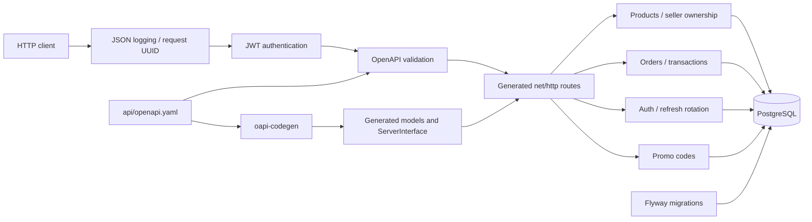
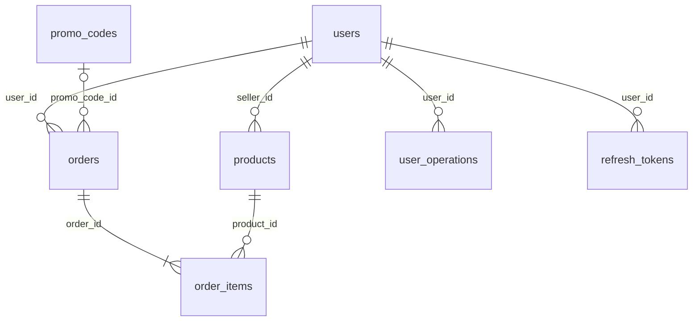

# Архитектура ДЗ №2

Одно Go-приложение, PostgreSQL и отдельный контейнер миграций Flyway. Микросервисы из ДЗ №1 для этого задания не нужны: каталог и заказы используют общую транзакцию, чтобы резервирование было атомарным.

## Структура

| Путь | Назначение |
|---|---|
| `api/openapi.yaml` | Исходный контракт |
| `api/oapi-codegen.yaml`, `api/generate.go` | Воспроизводимая генерация и embedding |
| `internal/api/generated.go` | Сгенерированные модели, enums, интерфейс и маршруты; игнорируется Git |
| `internal/config` | Проверка настроек окружения |
| `internal/app/middleware.go` | JWT, валидация, журнал запросов и маскирование |
| `internal/app/auth.go` | Регистрация, bcrypt, JWT, ротация refresh |
| `internal/app/products.go` | CRUD товаров и владение продавца |
| `internal/app/orders.go` | Заказы, блокировки и транзакции |
| `internal/app/promos.go` | Промокоды и точная арифметика скидок |
| `internal/app/errors.go` | Единый формат ошибок |
| `migrations` | Версионированные миграции Flyway |
| `scripts/e2e.py` | Демонстрация через HTTP и SELECT |

DTO не дублируются во внутренних структурах. Отдельные структуры `claims` и `principal` описывают JWT и контекст авторизации, а не API-запросы/ответы.

## Данные

Деньги — `DECIMAL(12,2)` в PostgreSQL и `decimal.Decimal` в Go. ID — BIGINT. Время — TIMESTAMPTZ, автоматические defaults и триггеры `updated_at`. Описания товаров и ссылка заказа на промокод nullable.

## Транзакции и конкуренция

Уровень изоляции мутаций — стандартный PostgreSQL READ COMMITTED с явными row locks. Порядок блокировок для всех операций над заказом одинаков:

1. `users ... FOR UPDATE` для владельца заказа. Запросы одного владельца сериализуются, включая действия ADMIN. Проверка частоты и активного заказа проходит под этой блокировкой.
2. При изменении существующего заказа — `orders ... FOR UPDATE`.
3. Все затронутые товары, включая старые позиции, — `products ... FOR UPDATE` **в порядке возрастания ID**.
4. Промокод — `FOR UPDATE` или атомарный UPDATE с блокировкой строки.

Таким образом, разные покупатели не могут списать один остаток дважды, проверка лимита промокода согласована с инкрементом, а одинаковый порядок блокировок товаров устраняет взаимное ожидание из-за противоположного порядка позиций.

На уровне БД дополнительно работают CHECK stock >= 0, current_uses BETWEEN 0 AND max_uses и частичный UNIQUE index на user_id в состояниях CREATED/PAYMENT_PENDING. Индекс products(status) соответствует заданию; user_operations имеет индекс поиска последней операции. Внешние ключи покрыты индексами, в том числе составными и частичными; дополнительные индексы добавлены отдельной миграцией V2.

Создание: резерв → промокод → orders → order_items → user_operations → commit. Обновление: возврат → резерв → пересчёт → замена позиций → user_operations → commit. Отмена: возврат → возврат использования промокода → CANCELED → commit. Любая ошибка вызывает rollback.

При GET заказа и списка товаров используется read-only REPEATABLE READ, чтобы позиции, суммы и count/page читались из согласованного снимка.

Refresh token блокируется по `jti`, затем отзывается и заменяется новым в одной транзакции. Конкурентное повторное использование старого refresh не выдаёт вторую пару токенов.

## Проверка контракта

`kin-openapi` валидирует вход до бизнес-обработчиков. Интеграционные тесты отдельно валидируют ответы по исходному контракту, включая ошибки и пустые DELETE-ответы. Это проверяет соответствие реализации спецификации в обе стороны.

Повторяющиеся товары, порядок дат промокода, владение, актуальность промокода и переходы состояний — семантические проверки, для которых недостаточно базовых ограничений JSON Schema.
